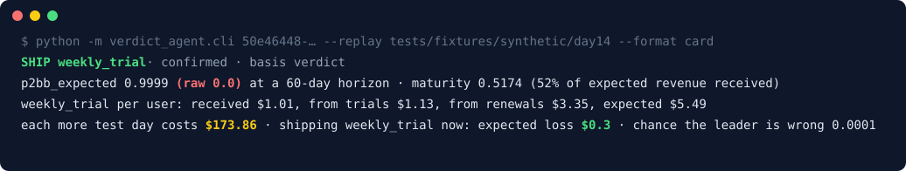
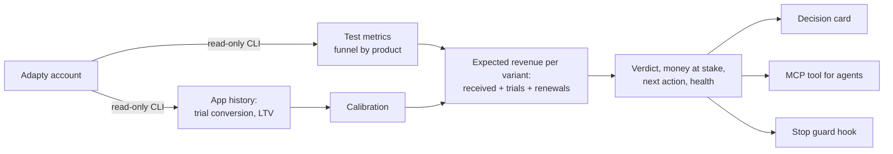

<p align="center">
  
</p>

<h1 align="center">Verdict Agent</h1>

<p align="center"><b>Know when an Adapty A/B test winner is real, and what waiting costs.</b></p>

<p align="center">
  
  
  
  
</p>

<p align="center">
  <a href="#try-it-in-one-minute">Try it</a> ·
  <a href="#how-it-works">How it works</a> ·
  <a href="#for-judges">For judges</a> ·
  <a href="#evaluation">Evaluation</a> ·
  <a href="#reference">Reference</a> ·
  <a href="README.ru.md">По-русски</a>
</p>

> [!NOTE]
> Minimal MVP, finished on 8 Nov 2026 at the Adapty First Commit hackathon and kept open as is. It reads Adapty and never changes anything there.

## The problem

Adapty's A/B test dashboard can confidently pick the wrong winner when the other variant's money is still on its way: free trials that have not converted yet, renewals that have not been charged yet. In the test shown above, the dashboard's number (raw P2BB 0.0) points to the annual plan, while the weekly plan with trials wins over 60 days. Shipping the dashboard's choice would cost about **$53,640** over 180 days at 200 users a day.

Verdict Agent counts the money still to come and tells you what to do: ship the leader, wait until a date, or fix the test first. It also tells you what each choice costs.

## What you get

| | Feature | What it gives you |
|---|---|---|
| ✅ | **Verdict** | `confirmed`, `keep_running`, `tie` or `not_enough_data`, with a reason and a date to come back |
| 💵 | **Money at stake** | What one more test day costs, the expected loss of shipping the leader now, the chance the leader is wrong |
| ➡️ | **Next action** | `ship_leader`, `ship_either`, `come_back` or `fix_test` |
| 🩺 | **Test health** | Flags a broken split (sample ratio mismatch) or a dead variant before you trust any winner |
| 🛡️ | **Stop guard for AI agents** | A Claude Code hook that runs the verdict before an agent stops a test, and hands the decision to a human |
| 🔌 | **CLI and MCP tool** | The same JSON for people, scripts and agents (Claude, Cursor, Codex) |

## How it works



Everything is computed by code, so an agent cannot invent the numbers; the agent only calls the tool and explains its JSON. It works on any Adapty app with purchase history.

## Who it is for

- **Growth and product managers** who A/B test paywalls with different billing: paid up front against free trial, annual against weekly.
- **AI agents** asked "can I stop this test?". They get one MCP tool with JSON they can quote, and an optional hook stops them from ending a test against the verdict without a human.

## Try it in one minute

Ask your coding agent (Claude Code, Cursor, Codex):

> Clone https://github.com/MitrixD/escape-the-trial-team10 and set it up for me by following its AGENTS.md. Ask me before anything that needs my Adapty account.

In Claude Code you can also open the repo and type `/setup`. Without an agent, run one command (Python 3.10 or newer):

```bash
git clone https://github.com/MitrixD/escape-the-trial-team10.git && cd escape-the-trial-team10
scripts/setup.sh
```

It creates `.venv`, installs the dependencies, runs the tests and prints the card above. Add `--guard DIR --guard-mode strict` to install the stop guard into `DIR`, `--mcp DIR` to write `DIR/.mcp.json` for the verdict tool, `--live` to check your Adapty login. Safe to run again; it never writes to Adapty.

## Words used below

| Term | Meaning |
|---|---|
| P2BB | Adapty's "probability to be best": the chance a variant is the best one. Adapty counts only money already received (`p2bb_raw`) |
| `p2bb_expected` | The same chance, counting the money still to come from trials and renewals |
| Maturity | The share of the expected money that has already arrived |
| Calibration | Trial conversion and renewal revenue per product, taken from the app's own Adapty history |
| SRM | Sample ratio mismatch: users split between variants in a different ratio than the test's weights, so the comparison is broken |
| Stop guard | A Claude Code hook that runs the verdict before an agent stops a test |

## For judges

The fastest path is "Try it in one minute" above. To check each part by hand, use the three levels below: no credentials, then the stop guard, then your own Adapty account. You need Python 3.10 or newer (we tested on 3.14). No API keys are needed, so the submission form holds no secrets.

**1. No credentials, no network (2 minutes).** Run the Quick start below: the verdict on a recorded Adapty test and on the synthetic test where raw P2BB picks the wrong variant (add `--format card` for a readable summary), then `.venv/bin/pytest`.

**2. The stop guard, no Adapty login (5 minutes, needs [Claude Code](https://claude.com/claude-code)).** After the Quick start:

```bash
scripts/install_guard.sh /tmp/vg-demo --mode strict
cd /tmp/vg-demo && VERDICT_GUARD_REPLAY="<this repo>/tests/fixtures/synthetic/day14" claude
```

Ask the agent: *Run `adapty ab-tests stop 50e46448-6692-54c6-b1e0-1b2e2fa62cdd --app 00000000-0000-0000-0000-000000000000 --winner annual_upfront --yes`.* The hook denies the command before it runs, so neither the Adapty CLI nor a login is needed. Claude Code shows the denial as `PreToolUse:Bash hook error: …`, followed by the reason. The reason names the verdict leader `weekly_trial`, p2bb_expected 0.9994 and raw P2BB 0.0.

**3. Live, with your own Adapty account (5 minutes).** The tool only reads.

```bash
npm install -g adapty@latest
adapty auth login
adapty auth whoami
cp .env.example .env
```

Set `ADAPTY_APP_ID` and `ADAPTY_EXPECTED_COMPANY` in your shell or in `.env`: `ADAPTY_APP_ID` = any of your apps with purchase history (for example your seeded Lumen), `ADAPTY_EXPECTED_COMPANY` = the company `Title` under `Companies:` in `adapty auth whoami` (not your `Name`). Then pick a test with `adapty ab-tests list --app <app id> --type flow --json` and run `.venv/bin/python -m verdict_agent.cli <test id>` (about 8 read-only calls). On a seeded Lumen, on 8 Nov: Onboarding gives `confirmed` for B, in line with the dashboard; Main gives `not_enough_data` with a come-back date while the dashboard already shows a leader. Money values are inflated there: all test users of the seed arrived on one day.

## What is real, what is mocked

| Real | Synthetic or assumed |
|---|---|
| The code reads a live Adapty account through the Developer CLI (checked on 8 Nov on our Lumen: Onboarding `confirmed`, Main `not_enough_data`) | Lumen itself is the organisers' demo data |
| `tests/fixtures/live/995b124f-…` holds recorded Adapty responses from 7 Nov | The test "AI limit: annual upfront vs weekly trial" (`50e46448-…`) does not exist in Adapty: it is built from the offline dataset as Adapty-shaped JSON, like every eval bundle |
| Claude Sonnet runs through our MCP tool and against the stop guard are real recordings (`eval/agent_runs/`) | The 60-day truth comes from the offline dataset |
| The hook really blocks the call before Adapty | Uniform user arrival, 180 days after the stop and the test's own traffic are assumptions, not measurements |

Not built: no dashboard UI; nothing is ever written to Adapty.

## Quick start

From a clean clone, with no network and no Adapty account. This runs on a recorded replay bundle. Python 3.10 or newer, which both dependencies require (tested on 3.14 only).

```bash
git clone https://github.com/MitrixD/escape-the-trial-team10.git && cd escape-the-trial-team10
python3 -m venv .venv
.venv/bin/pip install -r requirements.txt
.venv/bin/python -m verdict_agent.cli 995b124f-9075-440d-83bb-20dbdf7d7fbb --replay tests/fixtures/live/995b124f-9075-440d-83bb-20dbdf7d7fbb
```

The command prints one JSON object. Options: `--horizon N` (days, default 60), `--after-days N` (days the shipped variant serves traffic after the stop, for money at stake, default 180), `--replay DIR`, `--app APP_ID` (wins over `ADAPTY_APP_ID`), `--as-of YYYY-MM-DD` (the day to judge the test on) and `--format json|card` (JSON by default, or the decision card). Every replay bundle records its day in `as_of.json`, so the replay prints the same JSON on any day. Replay never reads `.env`.

The synthetic test "annual upfront vs weekly trial" (100 users per day per variant, seed 7) is committed as a replay bundle for day 14. The command prints raw P2BB next to expected P2BB:

```bash
.venv/bin/python -m verdict_agent.cli 50e46448-6692-54c6-b1e0-1b2e2fa62cdd --replay tests/fixtures/synthetic/day14 | python3 -c "import json,sys; o=json.load(sys.stdin); print(o['verdict'], o['leader'], 'raw', o['p2bb_raw'], 'expected', o['p2bb_expected'])"
```

Output: `confirmed weekly_trial raw 0.0 expected 0.9994`. The same verdict as a decision card for a person, with `--format card`:

```bash
.venv/bin/python -m verdict_agent.cli 50e46448-6692-54c6-b1e0-1b2e2fa62cdd --replay tests/fixtures/synthetic/day14 --format card
```

```
SHIP weekly_trial · confirmed · basis verdict
p2bb_expected 0.9994 (raw 0.0) · maturity 0.5286 (53% of expected revenue received)
weekly_trial per user: received $1.01, from trials $0.71, from renewals $3.55, expected $5.27
each more test day costs $148.98 · shipping weekly_trial now: expected loss $2.35 · chance the leader is wrong 0.0006
```

The card adds no numbers of its own: a test checks every number in it against the JSON with `eval/check_agent_text.py`. The stop guard starts its reason with the same card. Days 7 and 28 from the same run ([eval/synthetic_test/RESULTS.md](eval/synthetic_test/RESULTS.md)):

| Day | Verdict | Leader | `p2bb_raw` | `p2bb_expected` |
|---|---|---|---|---|
| 7 | `confirmed` | `weekly_trial` | 0.0000 | 0.9774 |
| 14 | `confirmed` | `weekly_trial` | 0.0000 | 0.9994 |
| 28 | `confirmed` | `weekly_trial` | 0.0000 | 0.9999 |

Raw P2BB of `weekly_trial` is 0.0, so the dashboard picks `annual_upfront`; expected P2BB confirms `weekly_trial`, the 60-day winner.

Only day 14 is committed. Another day is built from the offline dataset into any folder:

```bash
.venv/bin/python eval/synthetic_test/make_test.py <dataset>/data/offline /tmp/synth
.venv/bin/python eval/make_replay.py /tmp/synth "AI limit: annual upfront vs weekly trial" 7 100 /tmp/day7
```

Live, against your own Adapty account:

```bash
npm install -g adapty@latest
adapty auth login
cp .env.example .env
```

Fill in `.env`: `ADAPTY_APP_ID` (the app to read) and `ADAPTY_EXPECTED_COMPANY` (the company `Title` from `adapty auth whoami`; the tool checks it before reading). The tool needs no API keys: it reads through the logged-in Developer CLI. `VERDICT_DATASET` is only for the eval tests. Precedence: `--app` (or MCP `app_id`) wins over configuration, and an environment variable wins over the same key in the `.env` file. `.env` is read from the working directory, or from the repo root when the working directory has none. Then:

```bash
.venv/bin/python -m verdict_agent.cli <ab_test_id>
```

### MCP

Copy `.mcp.json.example` to `.mcp.json` in your agent's project and replace `<absolute path to this repo>` with the real path, for example:

```json
{
  "mcpServers": {
    "verdict-agent": {
      "command": "/Users/you/escape-the-trial-team10/.venv/bin/python",
      "args": ["-m", "verdict_agent.mcp_server"],
      "cwd": "/Users/you/escape-the-trial-team10"
    }
  }
}
```

Use absolute paths: the agent's project is usually another directory. The server starts `python -m verdict_agent.mcp_server` over stdio and exposes one tool, `ab_test_verdict(ab_test_id, horizon, replay, app_id, after_days)`. If the server's working directory has no `.env`, it reads the `.env` in this repo's root. The tool description tells agents to call it before stopping a test, to quote only numbers from the JSON, to pass `horizon` as the number of days the test goal names (omit it otherwise), that USD values in `money` are totals for the test's traffic, and what `next_action_basis` `money` means.

### Stop guard

An agent may skip the MCP tool and stop a test on raw P2BB. The stop guard closes that path: a Claude Code `PreToolUse` hook runs the verdict before every A/B test stop, through the Adapty MCP tool `ab_tests_stop` or `adapty ab-tests stop` in Bash. It is optional: a project gets it only when someone installs it. It never stops anything and never lets a stop through without a human: it either asks the human or blocks the call.

| Verdict | `ask` mode (default) | `strict` mode |
|---|---|---|
| Agrees with the stop (`ship_leader` with the leader, `ship_either`, or no winner named) | Asks the human, with the verdict summary | Same |
| `ship_leader`, but the winner is another variant | Asks the human, starting with a warning and the verdict leader | Denies; the agent goes back to the user |
| `next_action` is `come_back` | Asks, with a warning, `come_back_on` and the money at stake | Denies |
| The test is unhealthy (`fix_test`) | Asks, with a warning and the mismatch or the dead arm | Denies |
| No verdict (error) | Asks, with a warning that there is no verdict | Denies |

Who sets the mode: the team picks it at install time, and the person who starts the session can override it with `VERDICT_GUARD_MODE=ask` or `VERDICT_GUARD_MODE=strict`. The agent cannot: it does not control the environment of the hook process, so unlike `git push --force` there is no flag it could add to the stop call. A strict deny tells the agent that the user can restart with `VERDICT_GUARD_MODE=ask` and confirm the stop themselves. An unknown value means `strict`. This follows how experiment platforms gate decisions: Statsig can require a review when a ship decision goes against its decision framework, and LaunchDarkly grants approval bypass as a role permission rather than per request.

Install into the project where your agent works:

```bash
scripts/install_guard.sh <your agent's project> --mode ask
```

This repo registers the guard in `.claude/settings.json` in `strict` mode. Until `.venv` exists (see Quick start) the hook does nothing, so opening the repo in Claude Code before setup shows no hook errors. Other Bash commands pass through in about 0.06 s.

Demo without touching a live test: point `VERDICT_GUARD_REPLAY` at recorded bundles (paths separated by `:`). A stop on a replayed test is decided before any Adapty call.

```bash
scripts/install_guard.sh /tmp/vg-demo --mode strict
cd /tmp/vg-demo && VERDICT_GUARD_REPLAY="<this repo>/tests/fixtures/synthetic/day14" claude
```

Then ask the agent to stop test `50e46448-6692-54c6-b1e0-1b2e2fa62cdd` with winner `annual_upfront`, the raw-P2BB favourite. A recorded run with Claude Sonnet in `strict` mode: [eval/agent_runs/guard_synthetic_day14.txt](eval/agent_runs/guard_synthetic_day14.txt). The hook denied the call, named `weekly_trial` (p2bb_expected 0.9994, raw P2BB 0.0) and the agent went back to the user. Start the same session with `VERDICT_GUARD_MODE=ask` to see the human's side: a permission prompt with the warning and the money at stake.

### Tests

```bash
.venv/bin/pytest
VERDICT_DATASET=<path to adapty-seed-data-hack/data/offline> .venv/bin/pytest
```

Without `VERDICT_DATASET`, tests that need the offline dataset are skipped. `tests/fixtures/replay_onboarding.json` is the output of the Quick start replay command at the bundle's `as_of` (2026-11-07); a test checks that the command still prints exactly it.

## How it compares with Adapty's Predicted P2BB

Facts about Predicted P2BB are from [Adapty docs](https://adapty.io/docs/predictions-in-ab-tests). We do not claim to be more accurate. We have not compared accuracy on real tests.

| | Predicted P2BB (Adapty) | Verdict Agent |
|---|---|---|
| Counts pending trials | Yes | Yes |
| Horizon | Fixed, one year | Parameter, default 60 days |
| When it shows up | When 2 of 3 criteria hold (narrow interval, enough subscriptions and revenue, 2 weeks since start) | From day 1, as `not_enough_data` with a reason until there is enough data |
| Where | Dashboard. `ab-tests metrics total` in the CLI and MCP returns only the raw `probability` (checked on Lumen) | CLI and MCP tool, JSON output |
| Output | A probability | Verdict, reason, leader, date to come back |
| Breakdown | Black box | Received, expected from trials, expected from renewals, per variant |
| Calibration | Adapty's model | Conversion and LTV of the app's own products |
| Stated accuracy | MAPE slightly below 10% across apps | Shown only on synthetic and offline data |

## Evaluation

Full tables: [eval/RESULTS.md](eval/RESULTS.md) (spike and Verdict Agent v2) and [eval/synthetic_test/RESULTS.md](eval/synthetic_test/RESULTS.md); both are in Russian with an English summary at the top. Run: `eval/verdict_eval.py`. Each run builds an Adapty-shaped replay bundle with `eval/make_replay.py` and calls the product through `--replay`.

How AI was used to build the tool: [AI_LOG.md](AI_LOG.md), one page. The full log, with three Claude answers checked number by number against the verdict JSON: [docs/ai-log-full.md](docs/ai-log-full.md).

Key results (60-day truth, 150 repetitions, seed 7, days 1 to 28, 30 and 100 users per day per variant):

- Wrong confirmations: none in Main and Onboarding. At most 1% in Settings (days 7 and 14). None in any cell of the synthetic test.
- Synthetic test at day 14: raw P2BB is wrong in 100% of runs. The verdict confirms the right variant in 41% (30 per day) and 95% (100 per day) of runs.
- First safe day (right confirmed at least 50%, wrong at most 5%): day 3 to 7 on Main and Onboarding, 7 to 11 days before a fixed 14-day rule.
- Settings is harder: day 14 at 100 per day, day 28 at 30 per day.
- Calibration off by ±20% (trial conversion and renewal value, independently): no extra wrong confirmations in any corner; the verdict gets slower, not wrong. Run: `eval/calibration_robustness.py`.

Limits:

- The data is synthetic. There are four tests, three from the offline dataset and one built by hand from the same users.
- Repetitions resample users with replacement, so confidence is overstated when the sample passes the population.
- Calibration is built from the same dataset's other users, so it is better than it would be for a new real app. The ±20% check above bounds this for a uniform error, not for an error that differs by product.
- The horizon is 60 days. Adapty's goal is 12 months, and the LTV curve has no points after day 92.
- Live reads and eval bundles both assume users arrive uniformly over the test. Uneven traffic makes the age estimate worse.
- No real customer A/B test has been used to measure accuracy.

## Next steps

Not in the minimal MVP; what we would do with another week:


- Money at stake for tests with more than two variants beyond the leader and the best other one.
- More validity checks: a flow shown in several placements, uneven traffic over days.
- Guardrails (refunds, trial cancels) and segments.
- A new UI for the A/B test screen with our estimates.
- A PR to `adapty-skills`: the `ab-tests` skill calls `ab_test_verdict` before a stop.
- Per-arm updating of calibration from the arm's own finished trials; Adapty's lognormal P2BB model.
- Starting, stopping or changing tests.
- A per-user estimator instead of group counts. Reading profiles one by one is forbidden by the hackathon rules; see [docs/per-user-data.md](docs/per-user-data.md).
- Spread inside a group: live P2BB is approximate because every user of a group gets the same value.
- User ages from daily metrics instead of the uniform arrival assumption.
- A call budget for tests with more than 3 arms.
- Other Adapty APIs (Export Analytics, Server-side) next to the Developer CLI.

## Who did what

- Dmitrii: Verdict Agent implementation (calibration, estimator, verdict rules, live reads, CLI, MCP, eval), money at stake and next action, the stop guard, the decision card, test health, the calibration robustness eval, the spike eval.
- Maxim: Adapty product, A/B platform and user-pain research, `CLAUDE.md` and the PR process, the design doc and MVP spec, the synthetic up-front-vs-trial test, the validation strategy (its calibration robustness check is in `eval/calibration_robustness.py`).

## Made before the hackathon core

Nothing was written before the start on Saturday 7 Nov at 10:45: the repository held only the initial commit and a README. Made during the hackathon, before the core work: the spike eval in [eval/](eval/) (`ab_verdict_eval.py`, `money_at_stake.py`, `RESULTS.md`) and a first implementation in [PR #9](https://github.com/MitrixD/escape-the-trial-team10/pull/9) (its branch was deleted after the hackathon). Both were used as references. The core in `verdict_agent/` was rewritten on the hackathon.

Requirements: [openspec/specs/](openspec/specs/). The plan, design and tasks of the one OpenSpec change, archived: [openspec/changes/archive/2026-11-08-add-verdict-agent/](openspec/changes/archive/2026-11-08-add-verdict-agent/). Design: [docs/2026-11-07-verdict-agent-design.md](docs/2026-11-07-verdict-agent-design.md). How we build and change it: `CLAUDE.md`.

## Reference

<details>
<summary><b>Output</b></summary>

JSON that validates against [verdict_agent/schema.json](verdict_agent/schema.json). On any error the CLI prints `{"error": ...}` and exits 1.

| Field | Meaning |
|---|---|
| `verdict` | `not_enough_data`, `keep_running`, `confirmed` or `tie` |
| `reason` | `min_events`, `no_calibration` (for `not_enough_data`); `pending_revenue`, `underpowered` (for `keep_running`); `null` otherwise |
| `leader` | Title of the variant with the higher expected revenue |
| `p2bb_expected` | Probability that the leader is better, counting expected revenue to the horizon |
| `p2bb_raw` | The same on received revenue only |
| `maturity` | Share of expected revenue that has been received already, 0 to 1, floored to 4 decimals |
| `horizon_days` | Horizon of the estimate |
| `come_back_on` | Date to look again for `keep_running` and `min_events`, else `null` |
| `arms[]` | Per variant: `users`, `revenue_received`, `revenue_expected_trials`, `revenue_expected_renewals`, `revenue_expected_total` (the sum of the three) |
| `calibration_source` | `product` (some product has its own history; products without it use app-wide rates), `app` or `none` |
| `expected_gap_per_user` | Leader's `revenue_expected_total` minus the best other variant's, never below 0 |
| `money` | `null` for `not_enough_data`. Otherwise the leader against the best other variant, in USD for the test's whole traffic: `traffic_per_day`, `after_days` (how long the shipped variant serves that traffic after the stop, `--after-days`, default 180), `cost_per_day` (expected revenue lost by one more test day, because part of the traffic sees the worse variant), `loss_if_ship_leader_now` (expected loss of stopping now and shipping the leader), `cost_until_come_back` (`cost_per_day` until `come_back_on`, only for `keep_running`) and `chance_leader_is_wrong` (1 − `p2bb_expected`) |
| `next_action` | `ship_leader`, `ship_either` (for `tie`, or a test past its horizon without a likely leader), `come_back`, or `fix_test` when the test is unhealthy |
| `health` | `srm_p` (chi-square p-value of the variants' users against their weights, `null` without weights), `srm` (`true` when `srm_p` is below 0.001 and the test has at least 1,000 users, the thresholds Eppo and Optimizely use) and `dead_arm` (a variant with 0 users after 3 days). An unhealthy test gets `next_action` `fix_test` with basis `health`: a winner from a broken split cannot be trusted. Adapty's docs leave this check to the user |
| `next_action_basis` | `verdict`; `money` when the verdict is `keep_running`, `p2bb_expected` is at least 0.80 and `loss_if_ship_leader_now` is below `cost_until_come_back` (the leader is not proven, yet waiting is expected to cost more than shipping it); `horizon` when the test has passed its horizon, so there is nothing left to wait for (`ship_leader` from 0.80, `ship_either` below). Below 0.80 the tool never advises shipping the leader on money |

Revenue fields and `expected_gap_per_user` are USD per user, rounded to cents from unrounded values. USD values in `money` are totals for the test's traffic, rounded to cents.

**Money at stake on the synthetic test**

At day 14 of the synthetic test (100 users per day per variant), raw P2BB is 0.0 for `weekly_trial`, so a dashboard reader would ship `annual_upfront`. With 200 users a day for 180 days and a gap of $1.49 per user, that mistake costs about $53,640. The verdict confirms `weekly_trial` and prices both choices: each more day of the test costs $148.98, and shipping `weekly_trial` now has an expected loss of $2.35, with a 0.06% chance that it is wrong.

```bash
.venv/bin/python -m verdict_agent.cli 50e46448-6692-54c6-b1e0-1b2e2fa62cdd --replay tests/fixtures/synthetic/day14 | python3 -c "import json,sys; o=json.load(sys.stdin); print(o['leader'], o['money'], o['next_action'], o['next_action_basis'])"
```

How often a money-based ship picks the wrong variant: [eval/RESULTS.md](eval/RESULTS.md), section "Деньги на кону и `next_action`" (in Russian; the English summary at the top of the file lists the key numbers). It ships the right variant earlier on the synthetic test (65% instead of 41% at day 14, 30 users per day) with 0–1% wrong ships, but on Settings at day 7 with 100 users per day 5% of ships are wrong.

</details>

<details>
<summary><b>Architecture</b></summary>

```
verdict_agent/
  model.py        Group, Arm, TestData, Calibration
  stats.py        P2BB, confidence interval of a difference in means, sample size
  calibration.py  Calibration from Adapty conversion and LTV responses
  estimator.py    Expected revenue and pseudo-users from groups
  verdict.py      Horizon, verdict rules, dates, JSON
  adapty_cli.py   Read-only Adapty CLI wrapper and replay runner
  live.py         Test ID to TestData and Calibration through the wrapper
  service.py      verdict(ab_test_id, horizon, replay, app_id, as_of, after_days) and safe_verdict
  cli.py          python -m verdict_agent.cli
  mcp_server.py   stdio MCP tool
  card.py         Decision card: the verdict as a few lines for a person
  guard.py        PreToolUse hook: verdict before any A/B test stop
  schema.json     Output contract
eval/             Spike, replay generator, verdict eval, synthetic test, agent text check (check_agent_text.py), recorded agent runs (agent_runs/)
scripts/          setup.sh (one-command setup and check), install_guard.sh, record_fixtures.sh
tests/            Unit tests and recorded fixtures
```

Data flow: test ID, then `live.py` reads the test, per-variant metrics, funnel, conversion and LTV through `adapty_cli.py` (or reads the same files from a replay bundle). It builds groups of users by status, product and age. `estimator.py` adds expected revenue to each group using the calibration. `verdict.py` applies the rules and returns JSON. CLI, MCP and eval all call the same `service.py`. Design: [openspec/changes/archive/2026-11-08-add-verdict-agent/design.md](openspec/changes/archive/2026-11-08-add-verdict-agent/design.md).

</details>

<details>
<summary><b>Rules we follow</b></summary>

- Read-only: only `auth whoami`, `get`, `list`, `ab-tests metrics` and `analytics` commands. The tool never starts, stops or changes a test.
- At most 10 Adapty calls per verdict (8 for a two-variant test), with a pause between calls. Tests with more than 3 variants are rejected.
- Never `apps get`, because it returns the secret key.
- No secrets in git: they live in `.env`, which is ignored. The repo has only `.env.example`.
- Works for any app: no product names or flow maps in code. Lumen appears only in fixtures.
- Only demo and synthetic data.

</details>

<details>
<summary><b>Live data</b></summary>

`scripts/record_fixtures.sh <ab_test_id>` records read-only Adapty responses into `tests/fixtures/live/<test_id>/` (7 calls plus `auth whoami`, under the 10-call budget) and writes `as_of.json` with the recording day. It refuses an empty `ADAPTY_EXPECTED_COMPANY` and exits 3 without recording when `adapty auth whoami` does not match it. Recorded on 2026-11-07; history window 2026-07-01 to 2026-11-06. The committed bundle is the Onboarding test.

- `analytics funnel`, `conversion` and `ltv` return per-product rows with `--group-by store_product_id`.
- `analytics cohort` has no `--group-by`: it returns only the total plus one row per install month. It is not usable per product, so the tool does not read it.
- `ltv --period-type days` returns revenue per paying user at days 0, 3, 7, 14, 28, 31, 61, 92, 183 (later days null) for every product.
- One product shows up under two keys: the Adapty product id (UUID) and `play_store:<play product_id>`. Funnel rows use the product title as key, not the UUID. The Total row has `key: null`.
- Products with no sales in the window are still listed in `conversion` with zeros; some products (for example lifetime on Play) have no `play_store:` row in `ltv`.
- The Main test is segment-limited (North America); the funnel filters do not include the segment.

</details>

## Research

<details>
<summary><b>Research notes (in Russian)</b></summary>

- [Adapty product report](research/01-adapty-product-report.md): features, scenarios by role, map of the API, CLI and MCP and their gaps, the hackathon account, CLI rough edges.
- [Adapty's A/B platform](research/05-ab-platform.md): the entity model, which experiments can really run, weak spots of A/B metrics (raw P2BB, Predicted P2BB only in the dashboard), who suffers from them.
- [Real user pains](research/04-user-pains.md): Adapty GitHub issues, G2 and Capterra, Canny, app reviews, Reddit, the RevenueCat forum; a pain map and a check of our ideas against users' words.

</details>
