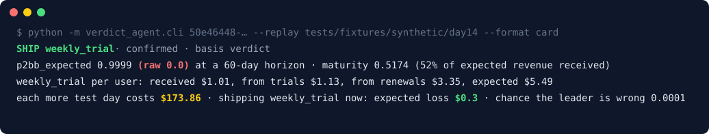

<p align="center">
  
</p>

<h1 align="center">Verdict Agent</h1>

<p align="center"><b>Понять, настоящий ли победитель A/B-теста в Adapty и сколько стоит ожидание.</b></p>

<p align="center">
  <a href="#как-запустить">Как запустить</a> ·
  <a href="#термины">Термины</a> ·
  <a href="#что-настоящее-а-что-нет">Что настоящее</a> ·
  <a href="README.md">English (основная документация)</a>
</p>

> [!NOTE]
> Минимальный MVP закончен 8 ноября 2026 года на хакатоне Adapty First Commit и оставлен открытым как есть. Агент только читает Adapty и ничего в нем не меняет.

## Что делает

Дашборд A/B-тестов Adapty может уверенно назвать победителем не тот вариант, если деньги другого варианта ещё в пути: бесплатные триалы не перешли в оплату, продления не списались. Verdict Agent досчитывает эти деньги и говорит, что делать: раскатывать лидера, ждать до конкретной даты или сначала чинить тест. И называет, сколько стоит каждый вариант.

Пример: в синтетическом тесте дашборд за годовой план, а на горизонте 60 дней выигрывает недельный план с триалом. Раскатка по дашборду стоила бы около $53 640 за 180 дней при 200 пользователях в день. Verdict Agent подтверждает недельный план, а каждый лишний день теста оценивает в $148,98.

Работает с любым приложением в Adapty, у которого есть история покупок.

Что получает пользователь:

- **Вердикт:** `confirmed`, `keep_running`, `tie` или `not_enough_data`, с причиной и датой, когда вернуться.
- **Деньги на кону:** сколько стоит ещё один день теста, сколько потеряем, если раскатить лидера сейчас, и шанс, что лидер неверный.
- **Следующий шаг:** раскатить лидера, любой вариант, вернуться позже или сначала починить тест, если сплит сломан (SRM или мёртвый вариант).
- **Предохранитель для агентов:** хук Claude Code не даёт агенту остановить тест вопреки вердикту без человека.

## Для кого

- Growth- и продуктовые менеджеры, которые тестируют пейволы с разной схемой оплаты: сразу против триала, годовой против недельного.
- AI-агенты, которых спрашивают «можно ли останавливать тест». Им достаётся один MCP-инструмент с JSON, который можно цитировать.

## Термины

| Термин | Что значит |
|---|---|
| P2BB | «Probability to be best» в Adapty: шанс, что вариант лучший. Adapty считает его только по уже полученным деньгам (`p2bb_raw`) |
| `p2bb_expected` | Тот же шанс, но с учётом денег, которые ещё придут от триалов и продлений |
| Maturity | Какая доля ожидаемых денег уже пришла |
| Калибровка | Конверсия триалов и выручка от продлений по продуктам из истории самого приложения в Adapty |
| SRM | Пользователи разделились между вариантами не в той пропорции, что задана в тесте: сравнению нельзя верить |
| Хук | Проверка в Claude Code, которая запускает вердикт перед тем, как агент остановит тест |

## Как запустить

**Быстрее всего — через AI-агента.** Откройте репозиторий в Claude Code и наберите `/setup` или дайте любому агенту промпт:

> Склонируй https://github.com/MitrixD/escape-the-trial-team10 и настрой по его AGENTS.md. Спроси меня перед всем, что требует моего аккаунта Adapty.

**Без агента — одна команда:**

```bash
git clone https://github.com/MitrixD/escape-the-trial-team10.git && cd escape-the-trial-team10
scripts/setup.sh
```

Скрипт находит Python 3.10+, создаёт `.venv`, ставит зависимости, прогоняет тесты и печатает карточку решения на синтетическом тесте:

```
SHIP weekly_trial · confirmed · basis verdict
p2bb_expected 0.9994 (raw 0.0) · maturity 0.5286 (53% of expected revenue received)
weekly_trial per user: received $1.01, from trials $0.71, from renewals $3.55, expected $5.27
each more test day costs $148.98 · shipping weekly_trial now: expected loss $2.35 · chance the leader is wrong 0.0006
```

Флаги: `--guard ПАПКА --guard-mode strict` ставит хук, `--mcp ПАПКА` пишет `.mcp.json` для инструмента, `--live` проверяет вход в Adapty CLI и `.env`. Учётные данные и ключи API не нужны. Для живого чтения войдите своим аккаунтом (`adapty auth login`) и укажите в `.env` своё приложение и компанию.

## Что настоящее, а что нет

- **Настоящее:** чтение живого аккаунта Adapty через CLI, записанные ответы Adapty в `tests/fixtures/live/`, прогоны Claude Sonnet через наш MCP и против хука.
- **Синтетика:** демо-приложение Lumen от организаторов. Синтетический тест «AI limit: annual upfront vs weekly trial» в Adapty не существует, он собран из офлайн-датасета. Правда на 60 дней тоже взята из датасета.
- **Допущения:** равномерный приход пользователей, 180 дней после остановки.

Цифры и ограничения eval — в [eval/RESULTS.md](eval/RESULTS.md). Как мы использовали AI — в [AI_LOG.md](AI_LOG.md).
