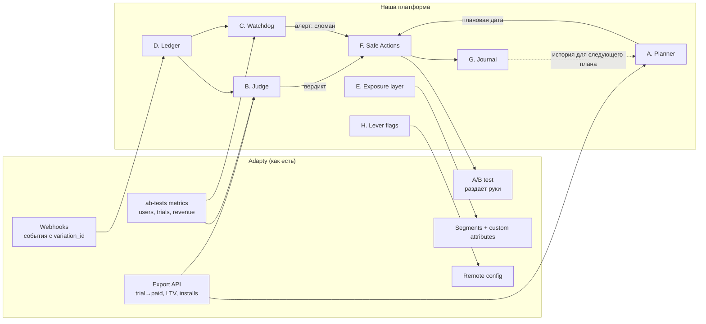

# Альтернативная A/B-платформа поверх Adapty: фичи и MVP

Опирается на [03-ab-platform.md](03-ab-platform.md); номера вида «3.1.4» отсылают к его разделу 3.

**Идея одной фразой.** Adapty хорошо **раздаёт варианты и считает деньги**, но плохо **помогает решить**: когда тест готов, можно ли верить победителю и ничего ли не сломалось. Мы строим «мозг» поверх Adapty, а раздачу вариантов и сбор выручки оставляем ему.

---

## 1. Главные слабые места и как мы их закрываем

| # | Боль | Как решаем (простыми словами) |
|---|---|---|
| 1 | **Победитель объявляется раньше, чем пришли деньги** (3.1.1). Рука с длинным триалом проигрывает, пока триалы не закончились | Мы досчитываем деньги, которые ещё придут: открытые триалы умножаем на исторический trial→paid этого продукта в этом приложении. Получается честная «ожидаемая выручка на пользователя», и вердикт «рано» вместо ложного «B победил» |
| 2 | **Непонятно, сколько ждать и когда остановиться** (3.1.4) | До старта мы по истории приложения считаем, сколько пользователей и дней нужно, чтобы заметить разницу, например, в 10%. Тест получает дату окончания, и до неё кнопка «остановить» показывает «рано» |
| 3 | **100% уверенности на 35 покупках** (3.1.5) | Мы показываем вместе с вероятностью размер выборки и честный интервал. Пока у рук мало плательщиков, вердикт — «данных мало», каким бы ни был P2BB |
| 4 | **Выручка растёт, а рефанды и отмены — тоже** (3.1.7) | Каждая рука сравнивается с контролем по страхующим метрикам: refund rate, доля отключённых триалов, отмены. Если рука лучше по деньгам, но хуже по ним, победителем она не объявляется, а нас предупреждают |
| 5 | **Трафик делится не так, как задумано, и никто не знает** (3.1.8) | Мы сверяем число назначенных пользователей в каждой руке с весами обычным χ²-тестом. При перекосе тест помечается «сломан», а его результаты — «не верить» |
| 6 | **Holdout «без пайвола» не измерить** (2.3, 3.1.6) | Мы считаем выручку на **назначенного** пользователя (поле `users`), а не на зрителя. Тогда пустая рука честно сравнивается с рукой с пайволом |
| 7 | **Тест сломался тихо: 0 просмотров, всплеск рефандов** (3.3.18) | Сторож опрашивает метрики по расписанию и шлёт алерт в Slack или Telegram, как только у руки пропали просмотры или ухудшилась страхующая метрика. Сейчас это видно, только если зайти в дашборд |
| 8 | **Тесты на разных экранах мешают друг другу, нет общего контроля** (3.2.13) | Каждому пользователю один раз присваивается «корзина» 0–99 в custom attribute. Корзины 0–4 становятся вечным контролем через сегмент с высшим приоритетом, а остальные делятся на слои, чтобы тесты не пересекались |
| 9 | **Никто не помнит, что тестировали и почему остановили** (3.1.9) | При каждой остановке мы сохраняем карточку: гипотеза, победитель, причина, цифры и страхующие метрики. Из этого журнала следующий тест планируется на основе прошлых, а не с нуля |
| 10 | **Остановили не тот тест или не с тем победителем** (3.2.11) | Любое необратимое действие идёт через карточку «кто что увидит с какого момента» и подтверждение человеком. Остановку по плановой дате мы делаем сами |
| 11 | **Рычаги вне пайвола не тестируются: когда показывать, частота** (3.2.15) | Рукой становится пустой или одинаковый флоу с разным remote config (`show_after_n_actions`, `show_paywall`), а приложение читает флаг. Мерить такие тесты мы можем благодаря счёту на назначенного пользователя (п. 6) |

---

## 2. Из каких фич состоит платформа

### Модули

| Модуль | Что делает | На чём стоит | Что мы достраиваем сами |
|---|---|---|---|
| **A. Planner** | Калькулятор выборки и длительности, MDE, плановая дата окончания | Export API: `conversion`, `installs`, `ltv` по продуктам; `placements metrics` (просмотры в день) | Формула размера выборки для выручки на пользователя; дисперсию берём из истории |
| **B. Trial-aware Judge** | Ожидаемая выручка на назначенного пользователя с учётом открытых триалов, вердикт «рано / победитель / нет разницы» | `ab-tests metrics total --json`: `users`, `trials`, `trials_finished`, `active_trials_rate`, `revenue`, `purchases`; Export API `conversion trial-paid` и `cohort` по `store_product_id` | Модель «деньги, которые придут»; байесовское сравнение на пользователя (bootstrap) |
| **C. Watchdog** | SRM, мёртвая рука, страхующие метрики, смена лидера; алерты | Поллинг `ab-tests metrics total/get` (лимит 2 запроса/с); webhooks `subscription_refunded`, `trial_renewal_cancelled` с `variation_id` | Планировщик, пороги, отправка в Slack или Telegram |
| **D. Ledger** | Своё хранилище событий по рукам: LTV, продления и рефанды на пользователя | Webhooks с `variation_id`, `ab_test_id`, `profile_event_id` для дедупликации; S3 paywall-visits | Приём webhooks, дедупликация, таблица `assignment × event` |
| **E. Exposure layer** | Глобальный holdout и непересекающиеся слои | Custom attribute `exp_bucket` (float 0–99) → сегменты по диапазону → аудитория с высшим приоритетом | Сервис, который ставит корзину. В реальном приложении это одна строка `setUserAttributes` на первом запуске; на Lumen — server-side PATCH |
| **F. Safe Actions** | Start, stop, replace через карточку эффекта; автостоп по плановой дате | `ab-tests start/stop/replace --yes` (exit 6 без `--yes` описывает эффект) | Карточка, подтверждение, расписание |
| **G. Journal** | Карточка каждого завершённого теста: гипотеза, победитель, причина, цифры | `ab-tests get`, `metrics total` на момент остановки | Хранилище (markdown или JSON в Git), поиск «что уже пробовали» |
| **H. Lever flags** | Тесты тайминга, частоты и holdout через remote config | Flow или paywall remote config, `variationName` в SDK v4.2+ | Соглашение о ключах и шаблон кода для приложения |

### Как модули связаны

### Чего мы сделать не можем

Чтобы не обещать лишнего:

- **Свою раздачу вариантов.** Назначение руки делает Adapty, мы им не управляем. Слои (E) работают только через сегменты и приоритеты аудиторий.
- **Тест цены того же продукта.** По-прежнему нужен новый store-продукт.
- **Список всех пользователей теста.** Ledger видит только тех, у кого было денежное событие. Знаменатель (`users`) берём из агрегатов `ab-tests metrics`.
- **Predicted P2BB Adapty.** В API его нет, поэтому Judge — наш собственный прогноз.
- **Сегмент по диапазону float-атрибута** (`>=` и `<` через AND) мы ещё не проверили на живом API.

---

## 3. MVP к воскресенью 15:00

**Что показываем.** Одна команда или страница: на входе `ab_test_id`, на выходе **карточка решения**, а при согласии — действие и запись в журнал. Это модули A (упрощённо), B, C (без расписания), F и G.

**Сценарий демо на Lumen.** Тест `Onboarding: annual trial vs weekly first`.

1. **Что говорит Adapty.** B: P2BB 100%, p = 7.7e-9, $1,528 против $0. Дашборд предлагает остановить с победителем B.
2. **Что говорим мы.**
   - **Вердикт: «Рано».**
   - У A 0 закончившихся триалов из всех открытых. С учётом trial→paid annual-триала в этом приложении (≈35%) ожидаемая выручка на пользователя такая-то, и разница с B в пределах шума.
   - SRM в норме: 285 против 254 при 50/50.
   - Страхующие метрики ещё не наблюдаемы: рефандов и отмен пока нет.
   - До плановой даты N дней.
3. **Действие.** «Не останавливать». Карточка уходит в журнал. Для контраста показываем тест `Settings`: 0.8 с, без данных и без победителя. Для него журнал фиксирует «сломан, без вывода».
4. **Бонус, если успеем.** Через `setTransaction` с `variation_id` досеиваем закрытие триалов в A и показываем, как вердикт меняется на «нет разницы» или «A лучше». Это «живая» часть: webhook → Ledger → Judge.

**Состав MVP по часам** (ориентир):

| Блок | Работа | ~часы |
|---|---|---|
| Сбор данных | Обёртка над CLI: `metrics total --json`, Export API `conversion trial-paid` и `ltv` по продуктам, бэкофф на 429 | 2 |
| Judge | Ожидаемая выручка на назначенного пользователя + bootstrap P(B > A) + правило «мало данных» | 3 |
| Проверки | SRM (χ²), мёртвая рука, страхующие метрики из `refunds` и `trials_cancelled` | 1 |
| Planner (упрощённо) | Нужная выборка по дисперсии из истории и текущему трафику → плановая дата | 1.5 |
| Карточка и действие | Текст или HTML-карточка, кнопка «остановить» → `ab-tests stop` с подтверждением, запись в журнал | 2 |
| Демо-данные | `setTransaction` с `variation_id` для досева | 1.5 |

**Ответы судьям одной строкой каждый:**

1. **Для кого.** Growth-менеджер подписочного приложения, который сегодня останавливает тесты «на глаз» по P2BB.
2. **Что меняется.** Меньше ложных победителей: не раскатываем руку, которая на самом деле теряет деньги или растит рефанды. Плюс меньше недель ожидания «на всякий случай».
3. **Почему Adapty.** Только он одновременно знает назначение руки и дальнейшую судьбу денег: триалы, продления, рефанды по сторам. AI здесь не обязателен: это статистика плюс прогноз триалов. LLM можно добавить только для текста карточки.
4. **Минимальная версия.** Карточка решения по одному живому тесту Lumen, которая спорит с дашбордом и объясняет почему.
