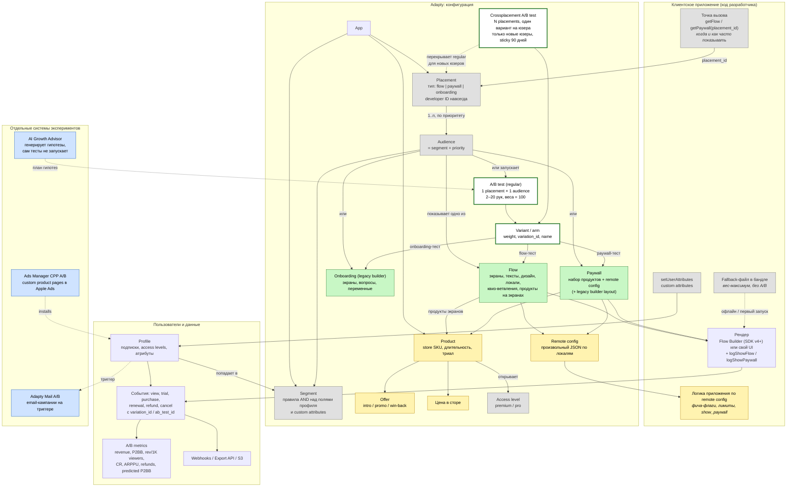

# A/B-платформа Adapty: что можно тестировать и где болит

Дата: 7 Nov 2026. Источники:

- **[docs]** страницы `ab-tests`, `ab-test-types`, `ab-test-no-paywall-variants`, `run_stop_ab_tests`, `results-and-metrics`, `maths-behind-it`, `predictions-in-ab-tests`, `developer-cli-ab-tests`, `fallback-paywalls`, `general` (stickiness), `ads-manager-cpp-ab-tests`, `mail-ab-testing`, `autopilot*`;
- **[CLI]** `adapty ab-tests * --help` (v0.18.0) и skill `adapty-skills:ab-tests`;
- **[Lumen]** живые данные нашего приложения на 7 Nov.

Пометка **(не проверено)** означает вывод из документации, который мы не подтвердили на живых данных.

---

## 1. Модель сущностей и места, где работает A/B

Зелёные узлы — это то, что **напрямую** становится рукой (arm) A/B-теста. Жёлтые — то, что можно варьировать **только косвенно**, через содержимое руки (другой пайвол или флоу с другими продуктами или remote config). Серые — то, что A/B-платформа Adapty **не тестирует** вообще. Синие — отдельные системы экспериментов вне основного A/B: Mail, CPP-тесты в Ads Manager.

PNG-версия: [05-ab-entities.png](05-ab-entities.png).

**Как читать.** Тест всегда привязан к одной паре **placement × audience**. Рука теста — это **целиком** флоу, пайвол или онбординг. Всё, что лежит «под» ними (продукты, цены, офферы, remote config), тестируется только тем, что вы делаете вторую копию флоу или пайвола и меняете в ней одну вещь. Всё, что «над» ними (когда звать плейсмент, кому показывать, что открывает access level), A/B-платформа не трогает.

### Что именно можно варьировать

| Сущность | Как попасть в тест | Тип | Пример на Lumen |
|---|---|---|---|
| **Flow** | Рука flow-теста. Нужен SDK v4+, флоу должен быть published, без unpublished changes | прямо | `onboarding`: annual trial vs weekly first |
| **Paywall** | Рука paywall-теста на плейсменте типа paywall | прямо | У Lumen paywall-плейсментов нет: `ab-tests list --type paywall` пуст |
| **Onboarding (legacy)** | Рука onboarding-теста. Есть только в дашборде, CLI не умеет | прямо | — |
| **Набор продуктов, их порядок, якорь** | Копия флоу или пайвола с другими продуктами | косвенно | `main`: 3 plans vs lifetime anchor |
| **Длительность триала, тип плана** | Другой **продукт** (свой SKU) в копии руки | косвенно | weekly 3-day trial vs annual 7-day trial |
| **Цена** | Только **новый store-продукт** с другой ценой (нужно ревью стора). Цену того же продукта протестировать нельзя | косвенно, медленно | — |
| **Offer** (intro, promo, win-back) | Копия руки, где экран продаёт продукт с другим оффером | косвенно (не проверено) | У Lumen офферов нет |
| **Дизайн, копирайт, порядок экранов, квиз** | Копия флоу в Flow Builder | прямо | — |
| **Локаль** | Нельзя выделить в руку, локаль выбирает SDK. Можно только отдельный тест на сегмент по стране | нет | — |
| **Remote config** (любой JSON) | Разный JSON в руках, приложение читает и ведёт себя по-разному | косвенно, нужен код | Holdout через `show_paywall=false` |
| **Показывать пайвол или нет (holdout)** | Пустая рука с `show_paywall=false` (официальный рецепт) | косвенно | — |
| **Связка экранов по всему приложению** | Crossplacement-тест, вариант = набор флоу на N плейсментах | прямо | Можно: `onboarding` + `settings_upgrade` + `ai_limit_reached` |
| **Когда и как часто вызывать плейсмент** | Не в Adapty, только через remote config и свой код | нет | — |
| **Кому показывать (segment, priority)** | Не тестируется: таргетинг — это политика, а не рука | нет | — |
| **Что открывает access level** | Не тестируется (можно через remote config-флаг в приложении) | нет | — |
| **Refund Saver, retention messaging, grace period** | Не тестируется | нет | — |
| **Email-кампании** | Отдельный A/B в Adapty Mail, свои метрики | отдельно | — |
| **Страница в App Store (CPP)** | Отдельный CPP A/B в Ads Manager, 2–4 варианта | отдельно | Lumen: 402, нет подписки |

---

## 2. Какие эксперименты реально запускать

### 2.1 Regular A/B test (flow, paywall, onboarding)

- Одна пара placement × audience. От 2 до 20 рук, веса — целые числа с суммой 100.
- Жизненный цикл: `draft → live → completed → archived`. Ни один переход нельзя отменить, кроме правки драфта.
- **Start.** Если у плейсмента есть аудитория этого сегмента, тест встаёт на неё, а тест, который там шёл, завершается. Если такой аудитории нет, Adapty **создаёт новую с наивысшим приоритетом**, и в тест тихо уходят пользователи, которые раньше попадали в другие аудитории [docs CLI]. Изменения долетают до пользователей **за время до 20 минут**.
- **Live.** Можно менять только title и goal. Новые веса или новые руки — только через `replace` (Modify): это **новый тест с новым ID**, все пользователи **перераспределяются заново**, число рук должно остаться прежним.
- **Stop.** Варианты: `--winner`, `--other` или `--no-content`, причём `--no-content` запрещён на All users. Перезапустить тест нельзя.
- **Подходит** для изолированной гипотезы на одном экране и для старых пользователей.

### 2.2 Crossplacement A/B test

- Вариант — это **набор** флоу или пайволов на нескольких плейсментах. Один пользователь видит один вариант везде.
- Приоритет у него выше, чем у regular-тестов.
- Ограничения:
  - участвуют **только новые пользователи**, которые ещё ни разу не вызывали `getFlow`/`getPaywall`;
  - нельзя смешивать флоу и пайволы, нельзя включать онбординги;
  - назначение **держится 90 дней даже после остановки** (настройка stickiness на уровне app). Пользователь **никогда больше** не попадёт ни в один другой crossplacement-тест;
  - на втором устройстве назначение появляется до 60 секунд или после следующего foreground;
  - в аналитике тест распадается на `child-0`, `child-1` и так далее, по одному на плейсмент;
  - **CLI создавать не умеет**, только дашборд.
- **Подходит** для проверки стратегии монетизации целиком: «вся экономика на annual» против «вся на weekly».

### 2.3 Holdout («пайвол против ничего»)

Официальный рецепт: две руки, во второй пустой флоу с `show_paywall=false`, и приложение само не рендерит. Документация прямо говорит **не логировать view** для пустой руки. При этом все результирующие метрики (P2BB, revenue per 1K, CR) считаются **на зрителя**. У holdout-руки зрителей ноль, поэтому сравнение по P2BB невозможно по построению (см. 3.1.6).

### 2.4 Смежные системы

| Система | Что тестирует | Чего нет в основном A/B, но есть здесь |
|---|---|---|
| **Ads Manager CPP A/B** | 2–4 custom product pages в Apple Ads, ротация слотами | **Калькулятор выборки**, выбор precision (MDE 1–5%) и confidence, автоматическое время окончания, «winner paused» до сопоставимых impressions |
| **Adapty Mail A/B** | Целые email-кампании на триггере | Метрики доставки и вовлечения. При Finish пользователи посреди цепочки не переключаются на победителя |
| **AI Growth Advisor** | Генерирует гипотезы (цены по гео, дизайн) и цепочку winner → challenger | Учитывает историю тестов. Но работает только с App Store-продуктами и тесты сам не запускает |

---

## 3. Слабые места и незакрытые боли

### 3.1 Статистика и принятие решения

1. **P2BB считается по уже полученной выручке.** Руки с длинным триалом, годовым планом или месячными продлениями в первые недели могут проигрывать просто потому, что их деньги ещё не пришли. **Поправка после офлайн-проверки** (Test Referee «в деньгах», результаты в `eval/RESULTS.md`):
   - в живом тесте `Onboarding` дашборд **прав**: B выигрывает и на 60, и на 90 днях ($8,56 против $4,52 на пользователя), так что тезис «100% — артефакт триалов» неверен;
   - сырой P2BB уверенно ошибается, когда **разница маленькая и у руки есть месячные продления**: в тесте Settings к 28-му дню 29% неверных решений против 1% у guard по ожидаемой выручке.

   P2BB = 100% при 35 покупках в день запуска — переуверенность (см. п. 5), но направление верное.
2. **Predicted P2BB есть только в дашборде.** По документации он учитывает триалы, но его нет в `ab-tests metrics total --json` и в Export API: мы проверили поля ответа, поля `predicted*` там нет **[CLI]**. Агент, работающий через CLI или MCP, и skill `ab-tests` видят только сырой P2BB. Прогноз появляется только при выполнении двух условий из трёх: узкий интервал, достаточно данных, прошло 2 недели. Cohort predictions **исчезают** при фильтре по A/B-тесту.
3. **Метрику цели выбрать нельзя.** Поле `goal` — свободный текст и ни на что не влияет. Решение всегда принимается по revenue per 1K viewers, где 14-дневный ARPU — прокси для годового. Нельзя задать первичную метрику вроде trial→paid, retention, refund rate, net revenue или LTV-60.
4. **Нет планирования и правила остановки.** Нет калькулятора выборки, MDE, плановой длительности и sequential-коррекции за подглядывания. Документация пишет «determine the threshold yourself… common is 95%». Дашборд **сам подсвечивает лидера и предвыбирает его в диалоге Stop**, то есть подталкивает остановить тест рано. У CPP-тестов в соседнем продукте всё это есть.
5. **Уверенность выглядит выше, чем есть.** При меньше чем 50 плательщиках в руке интервал «не смоделирован» и показывается как `0 / mean / 2×mean`. Но P2BB 100% и p-value рядом показываются как обычно **[Lumen]**. p-value есть только у flow-теста с ровно двумя руками. У paywall-тестов его нет, у тестов с 3+ руками тоже. P2BB за период — это не тренд, а для paywall-тестов ещё и накопленная сумма.
6. **Знаменатель — зрители, а распределяют пользователей.** Веса делят пользователей при fetch, а P2BB и CR считаются на view. Если приложение показывает руки с разной частотой, например в одной руке ранний выход, сравнение смещено. Holdout-рука без views вообще не сравнивается по P2BB. По документации `users` — это назначенные профили, но в P2BB эта метрика не используется. **Не проверено:**
   - на Lumen `users` = `views` = `installs` у обеих рук (285 и 254), так что по живым данным назначенных от зрителей не отличить;
   - проба через Web API (10 профилей, назначение без просмотра) вернула `variation_id`, которого нет среди рук flow-теста, а `users` не изменился.

   Пока это не подтверждено, holdout-измерение (2.3) остаётся гипотезой.
7. **Нет guardrail-метрик в решении.** Refund rate, trials cancelled и renewal cancellations есть в таблице, но в P2BB и в «лидера» не входят. Рефанды и отмены приходят с лагом. **[Lumen]** 32 из 58 рефандов приходятся на weekly-продукты, а 46% триалов отключили автопродление. Тест «weekly first» может выиграть по P2BB и проиграть по удержанию.
8. **Нет проверки SRM** (sample ratio mismatch). Расхождение `users` с весами никак не сигнализируется. **[Lumen]** В onboarding-тесте 285 против 254 при весах 50/50 — это ещё в пределах шума, но проверку надо делать руками.
9. **Нет памяти экспериментов.** У completed-теста нет полей `winner` и `stop_reason`. **[Lumen]** Тест `Settings` прошёл за 0.8 с, без данных и без победителя. Что проверили и чему научились — в API не узнать. Growth Advisor отчасти это закрывает, но только внутри своего плана.
10. **20 рук без поправки на множественные сравнения** и без механики выбывания слабых рук (bandit). Каждая лишняя рука растягивает тест.

### 3.2 Дизайн эксперимента и операционка

11. **Необратимость и жёсткость.** Live-тест нельзя поправить. `replace` перераспределяет **всех** пользователей, рвёт историю на два ID, а результаты старого и нового тестов не склеиваются. Нет постепенного раскатывания (10% → 50%), нет запуска и остановки по расписанию, нет автостопа по порогу.
12. **Одна аудитория на тест** и неявная смена приоритетов. Start без готовой аудитории ставит тест на самый верх и забирает пользователей из чужих аудиторий. Сегменты строятся только через AND. Если атрибут меняется посреди теста, пользователь может перейти в другую аудиторию и выпасть из своей руки (не проверено).
13. **Нет слоёв и глобального holdout.** Regular-тесты на разных плейсментах пересекаются бесконтрольно: пользователь сидит в трёх тестах сразу, и эффекты складываются. Нет mutual exclusion и нет постоянной контрольной группы «без изменений за квартал». Crossplacement решает задачу только для новых пользователей и только один раз в жизни пользователя.
14. **Цены и триалы тестируются медленно.** Нужен новый store-продукт, ревью Apple или Google и копия руки. Цену существующего продукта протестировать нельзя. Внутри хакатона ценовой тест не запустить.
15. **Рычаги вне пайвола не тестируются.** Когда показывать (после N действий, на `ai_limit_reached` или раньше), частота показа, что входит в `pro`, Refund Saver, retention-оффер при отмене, поведение при billing issue — всё это только через remote config и свой код, без поддержки в метриках. Как раз там у Lumen основные потери: отмены, рефанды и 50 billing-expirations без recovery.
16. **Fallback и офлайн выпадают из теста.** Fallback-файл отдаёт руку с наибольшим весом и не участвует в A/B. Пользователи, у которых первый запуск офлайн или медленный, системно попадают в одну руку и в тест не считаются. Сильнее всего это бьёт по онбординг-тестам.
17. **Задержки распространения:** до 20 минут на изменение аудитории, до 60 секунд на синхронизацию crossplacement между устройствами. Короткий тест на событии (акция или пуш) получается грязным в начале.

### 3.3 API, инструменты, наблюдаемость

18. **Нет событий о самом тесте.** Ничего не прилетает на «тест достиг значимости», «SRM», «лидер сменился» или «рука сломалась» (0 views, всплеск рефандов). Остаётся только поллинг с лимитом 2 запроса/с.
19. **Неполный программный доступ.**
    - В Export API нет фильтра по A/B.
    - Predicted P2BB недоступен через API.
    - Crossplacement- и onboarding-тесты из CLI не создаются.
    - `ab-tests list` по умолчанию показывает только flow-тесты.
    - `metrics get` требует `--type`.
    - На `--depth 3` purchases на уровне экрана и продукта равны 0.
20. **Разрозненные системы.** Paywall/flow A/B, Mail A/B, CPP A/B и Growth Advisor живут отдельно, у каждой свои метрики и своё «готово». Сквозной эксперимент «креатив → CPP → онбординг → пайвол → win-back email» с единым назначением и единой метрикой LTV не собрать.
21. **Сырые данные по назначению недоступны.** Per-user назначение видно только в webhooks (`variation_id`, `ab_test_id` в событиях выручки) и в ежедневном S3-экспорте paywall-visits. Своя статистика (CUPED, bootstrap, LTV по рукам) требует собирать собственное хранилище.

---

## 4. Кому это больно и что они делают сегодня

| Кто | Боль | Что делают сегодня |
|---|---|---|
| Growth-менеджер или PM | Не знает, когда остановить тест и можно ли верить 100% P2BB на триальном тесте (3.1.1, 3.1.4) | Ждёт «на глаз» 2–4 недели или останавливает рано и тиражирует ложного победителя |
| Аналитик | Нет сырых данных по рукам, нет predicted P2BB в API, нет guardrails и SRM (3.1.2, 3.1.6–8, 3.3.21) | Выгружает S3 и webhooks в свой DWH и считает в Python или Excel |
| Head of growth | Тесты на разных плейсментах пересекаются, нет holdout и нет «суммарного эффекта за квартал» (3.2.13) | Верит сумме uplift-ов отдельных тестов, которая всегда завышена |
| Разработчик | Holdout, тайминг и фича-флаги собираются руками через remote config. Fallback портит выборку (2.3, 3.2.15–16) | Пишет обвязку сам или держит отдельный флаг-сервис (Firebase, Statsig) |

---

## 5. Куда копать (для выбора идеи)

Сильнее всего «нужен Adapty» там, где Adapty знает назначение руки **и** дальнейшую судьбу денег: триалы, продления, рефанды. Никто другой этого не знает.

1. **Trial-aware судья теста** (бывшая идея 1). Проверена офлайн, результаты в `eval/RESULTS.md`. Сильна не на onboarding-тесте (там дашборд прав), а на тонких тестах с месячными продлениями. Дизайн: `docs/2026-11-07-verdict-agent-design.md`.
2. **Планировщик и сторож теста.** Калькулятор выборки и длительности по истории приложения. Поллинг метрик, алерты на SRM, на 0 views в руке и на guardrail (refund rate или cancel rate руки хуже контроля). Карточка «можно останавливать / рано / сломано». Закрывает 3.1.4, 3.1.7–8 и 3.3.18.
3. **Holdout-измеритель.** Правильный знаменатель (назначенные пользователи, а не зрители) для пустой руки и для теста «показывать пайвол раньше или позже». Закрывает 2.3, 3.1.6 и 3.2.15. **Только после проверки**, что `users` считает назначенных, а не зрителей.
4. **Журнал экспериментов.** Снимок теста при stop: победитель, причина, метрики, guardrails. Это база знаний, которую потом читает Growth Advisor. Закрывает 3.1.9.
