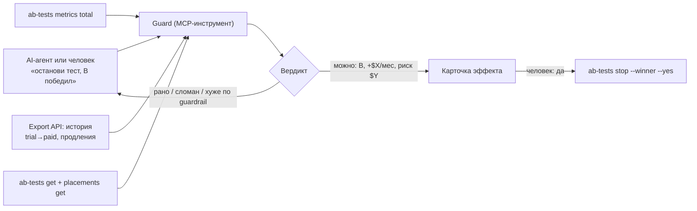

# Guard для A/B-решений поверх Adapty: фичи и MVP

Опирается на [05-ab-platform.md](05-ab-platform.md); номера вида «3.1.4» отсылают к его разделу 3.

**Это та же идея, что и раньше, а не новая.** Она выросла из **Trial-Aware Test Referee** (`02-extension-ideas.md`, идея 1) и **Test Referee «в деньгах»** (`03-dmitrii-ideas.md`, идея 2). Офлайн-проверка из `03` поменяла сюжет демо, и этот документ на ней стоит. Здесь добавлены форма продукта, проверки качества теста и состав MVP.

**Идея одной фразой.** Adapty хорошо **раздаёт варианты и считает деньги**, но агент или человек принимает решение по сырому P2BB. Мы встраиваем в этот момент **предохранитель (guard)**: он отвечает в долларах, можно ли останавливать тест и не сломан ли он. Это функция, которую Adapty может встроить к себе, а не замена их A/B.

---

## 1. Слабые места и как мы их закрываем

| # | Боль | Как решаем (простыми словами) | Статус |
|---|---|---|---|
| 1 | **Сырой P2BB уверенно ошибается в тонких тестах** (3.1.1). При маленькой разнице и месячных продлениях к 28-му дню 29% неверных решений (`03`, тест Settings) | Мы сравниваем руки по ожидаемой выручке на горизонте теста, а не по уже полученной. На том же тесте guard ошибается в 1% случаев | **MVP** |
| 2 | **Агент видит только сырой P2BB.** Predicted P2BB есть только в дашборде, а в CLI и MCP есть лишь `probability` (3.1.2) | Guard работает как MCP-инструмент, который агент обязан спросить перед `ab-tests stop`. Он возвращает вердикт и сумму в долларах, которую можно потерять, если ошибиться | **MVP** |
| 3 | **100% уверенности на 35 покупках** (3.1.5) | Рядом с вероятностью показываем размер выборки и интервал по каждой руке. Пока данных мало, вердикт — «данных мало», каким бы ни был P2BB | **MVP** |
| 4 | **Выручка растёт, а вместе с ней рефанды и отмены** (3.1.7) | Каждую руку сравниваем с контролем по refund rate, отключённым триалам и отменам. Если рука богаче, но хуже по этим метрикам, победителем она не объявляется | **MVP** |
| 5 | **Трафик делится не по весам, и никто об этом не знает** (3.1.8) | Сверяем число пользователей в руках с весами χ²-тестом. При перекосе тест помечается «сломан, результатам не верить» | **MVP** |
| 6 | **Тест сломался тихо: 0 просмотров, всплеск рефандов** (3.3.18) | Сторож по расписанию проверяет метрики и пишет в Slack или Telegram, если у руки пропали просмотры или испортилась страхующая метрика. В MVP проверка запускается по запросу, без расписания | **MVP** (по запросу) |
| 7 | **Holdout «без пайвола» не измерить** (2.3, 3.1.6) | Считать выручку на назначенного пользователя, а не на зрителя. **Сначала нужно проверить**, что поле `users` считает назначенных: на Lumen `users` = `views`, а проба через Web API ничего не доказала | Нужна проверка |
| 8 | **Рычаги вне пайвола: когда показывать, частота** (3.2.15) | Рукой становится одинаковый флоу с разным remote config, приложение читает флаг. Это зависит от п. 7 и требует кода в приложении | Позже |
| 9 | **Непонятно, сколько ждать** (3.1.4) | Калькулятор выборки и плановая дата по истории приложения. На Lumen история плейсментов есть только за 7.11, день всплеска установок, поэтому сначала нужно досеять историю | Позже |
| 10 | **Тесты на разных экранах пересекаются, нет общего контроля** (3.2.13) | Корзины через атрибут, сегменты и приоритет аудиторий. Схема хрупкая: диапазон в сегменте не проверен, аудитория с высшим приоритетом перебьёт текущие аудитории `main`, изменения долетают до 20 минут, нужен код в приложении. В исследовании болей (PR #4) никто этого не просит | Не делаем |
| 11 | **Нет памяти экспериментов** (3.1.9) | Карточка теста при остановке. В исследовании болей это самая слабая боль, и она пересекается с разделом «What you already tested» в growth-advisor | Не делаем |

---

## 2. Как устроен guard

### Модель Judge: не стирать тестируемый эффект

Первая версия умножала открытые триалы на исторический trial→paid продукта. Но тест триала или оффера меняет **качество** триалов: «weekly first» может приводить менее мотивированных пользователей. Тогда исторический априор тянет вердикт к «нет разницы». Поэтому:

- trial→paid и вероятность продления оцениваются **по каждой руке отдельно**. Исторические ставки приложения — только априор, например Beta с весом в N наблюдений;
- априор **обновляется закончившимися триалами и продлениями этой руки**: чем больше их закрылось, тем меньше вес истории;
- результат — не одно число, а **распределение ожидаемой выручки на пользователя для каждой руки**. Из него получаются P(B > A) и ожидаемая потеря в долларах при выборе каждой руки;
- выручка руки раскладывается на три части: «получено», «ожидается от триалов» и «ожидается от продлений». Так видно, на чём держится вердикт.

### Источники данных

| Что | Откуда |
|---|---|
| По рукам: users, views, trials, trials_finished, purchases, revenue, refunds, trials_cancelled | `ab-tests metrics total --json`; для агента — MCP `ab_tests_metrics_total` |
| Исторический trial→paid и продления по продукту | Export API `conversion` и `cohort` с фильтром `store_product_id` |
| Состав теста и кто что увидит после остановки | `ab-tests get` и `placements get` |
| События в реальном времени (позже) | Webhooks с `variation_id`, `ab_test_id`, `profile_event_id` |

### Безопасное действие

- **Карточку эффекта строим из двух чтений:** `ab-tests get` и `placements get`. Отсюда видно, какая аудитория, кто что видит сейчас и что увидит после остановки.
- **Запасной путь — CLI без `--yes`.** Документация CLI (`developer-cli-ab-tests`) описывает его как штатный для агентов: в неинтерактивном режиме команда ничего не отправляет, выходит с кодом 6 и описывает эффект. Skill `ab-tests` этому противоречит и запрещает так «смотреть эффект». Основным путём оставляем чтения, потому что в интерактивном терминале команда без `--yes` просто спросит подтверждение.
- **Решение принимает человек.** `ab-tests stop --winner <id> --yes` выполняется только после его «да» в ответ на эту карточку. Автостопа по дате нет: stop требует выбрать победителя, и это решение человека.

---

## 3. MVP к воскресенью 15:00

**Что показываем.** Агент собирается остановить тест по сырому P2BB, guard его останавливает и объясняет в долларах.

### Демо

1. **Подготовка.** В Lumen досеиваем тест типа Settings: маленькая разница, у одной руки месячные продления. Берём офлайн-датасет из `03`. Обе руки **разыгрываем по историческим ставкам с разбросом**, без подгонки под нужный вердикт. Показываем несколько прогонов, чтобы было видно: сырой P2BB в части прогонов уверенно выбирает не ту руку.
2. **Агент:** «P2BB у B 9x%, останавливаю с победителем B».
3. **Guard:**
   - «Стоп. По ожидаемой выручке на горизонте теста разница $A ± $B на пользователя».
   - «Ошибиться сейчас стоит ~$Y».
   - «В тестах такого типа сырой P2BB ошибается в 29% случаев, а это правило — в 1%».
   - «Проверки: SRM в норме, просмотры есть у обеих рук, рефанды не хуже».
4. **Контрольный кадр — живой onboarding-тест.** Здесь guard **соглашается с дашбордом**: B впереди. Это показывает, что guard не спорит ради спора. Заодно на нём видна проверка SRM: 285 против 254, χ² ≈ 1,8, p ≈ 0,18, в норме.
5. **Действие.** Карточка эффекта, «да» человека, `stop`. Только на досеянном тесте, не на живом.

### Состав по часам (ориентир)

| Блок | Работа | ~часы |
|---|---|---|
| Данные | Обёртка над CLI или MCP плюс Export API по продуктам; бэкофф на 429 | 2 |
| Judge | Ставки по рукам с априором, Monte Carlo ожидаемой выручки, P(B > A), ожидаемая потеря в $ | 3 |
| Проверки | SRM (χ²), мёртвая рука, guardrails из `refunds` и `trials_cancelled` | 1 |
| MCP-инструмент и карточка | Вердикт и карточка эффекта из двух чтений | 2 |
| Досев демо | Тест типа Settings в Lumen, прогоны по историческим ставкам | 2 |

### Ответы судьям

1. **Для кого.** Growth-менеджер подписочного приложения и его AI-агент, которые сегодня останавливают тест по сырому P2BB.
2. **Что меняется.** Риск: тонкие тесты не уводят решение не туда (29% → 1% неверных решений). Время: в очевидных тестах можно останавливаться раньше, не ждать 14 дней «на всякий случай».
3. **Почему Adapty и почему AI.**
   - **Adapty.** Только он одновременно знает назначение руки, триалы, продления и рефанды, и только у него есть кнопка остановки.
   - **AI.** Ядро — статистика. AI записывает контракт теста (MDE, горизонт, guardrails), объясняет вердикт простыми словами и работает MCP-предохранителем для агентов, которые сейчас выбирают лидера по сырому P2BB.
4. **Минимальная версия.** MCP-инструмент, который на одном досеянном тесте останавливает агента и объясняет почему, а на живом тесте соглашается с дашбордом.

---

## 4. Чего мы сделать не можем или пока не знаем

- **Свою раздачу вариантов.** Назначение руки делает Adapty.
- **Тест цены того же продукта.** Нужен новый store-продукт.
- **Predicted P2BB Adapty.** В API его нет, поэтому Judge — наш собственный прогноз.
- **`users` = назначенные пользователи?** Не проверено. На Lumen `users` = `views`. Проба: 10 профилей получили назначение через Web API без просмотров. Web API отдаёт flow-плейсмент, но с `variation_id`, которого нет среди рук теста, и `users` не изменился, по крайней мере сразу. Нужна проверка через реальный SDK или повторный замер позже.
- **Диапазон в сегменте по float-атрибуту** (`>=` и `<` через AND) не проверен. Это нужно только для слоёв, которые мы не делаем.
